<p align="center">
  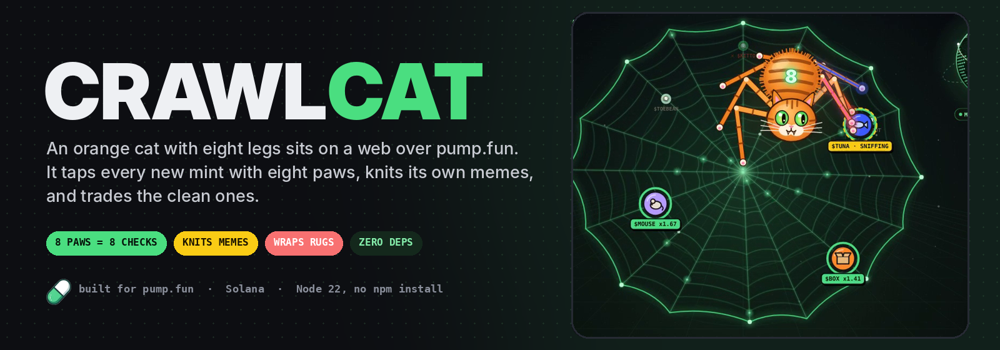
</p>

<p align="center">
  
  
  
  
  
  
  
</p>

<h3 align="center">I gave a cat eight legs and a pump.fun habit.<br>It wraps the rugs in yarn and knits its own memes.</h3>

<p align="center">
  <a href="#meet-crawlcat">Meet it</a> ·
  <a href="#60-second-start">60-second start</a> ·
  <a href="#the-eight-paws">Eight paws</a> ·
  <a href="#knitting-a-meme">Knitting a meme</a> ·
  <a href="#the-crew">The crew</a> ·
  <a href="#the-trade-desk">Trade desk</a> ·
  <a href="#the-yarn-desk">Yarn Desk</a> ·
  <a href="#status-read-this-first">Status</a> ·
  <a href="docs/SAFETY.md">Safety</a>
</p>

<p align="center">
  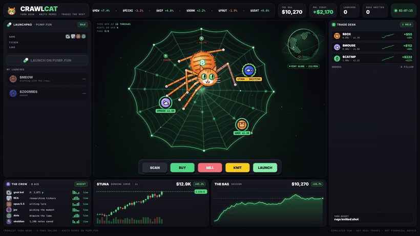
  <br><sub>The Yarn Desk in its demo session. Full 24-second cut with sound: <a href="docs/media/crawlcat-desk.mp4"><code>docs/media/crawlcat-desk.mp4</code></a>. Numbers on the desk are simulated.</sub>
</p>

---

## Meet CrawlCat

It is 3:07 AM and the cat is on the web.

Not *a* web. **The** web: a ring of sixteen threads strung over pump.fun, where every fresh mint lands the second it is deployed. About two hundred a minute. Most of them are traps.

When a thread shakes, the cat crawls over. It doesn't open dexscreener. It doesn't open four tabs. It puts **eight paws** on the coin at once, and each paw checks one thing:

> mint auth · freeze auth · liquidity · bundles · top 10 · socials · wash volume · dev wallet

One paw comes back wrong and the cat **hisses**, wraps the coin in yarn and drops it in the basket. It never buys it. All eight come back clean and it **pounces**.

When the market is quiet, it gets bored. It calls its crew, six AIs sitting around the desk. They find a narrative, check the ticker, write the lore, pick the moment, draw the coin, and remember everything. Then the cat sits down at the console, presses **KNIT**, knits a ball of yarn, and presses **LAUNCH**.

That's the whole personality. It has one rule it never breaks:

> *It doesn't touch real SOL until you tell it to, twice.*

---

## 60-second start

Needs Node 22.18 or newer. No `npm install`: CrawlCat has **zero dependencies**, and Node runs the TypeScript directly.

```bash
git clone <this repo> crawlcat && cd crawlcat
cp .env.example .env

node src/cli.ts                      # the cat introduces itself
node src/cli.ts scan <mint>          # tap any token with all eight paws
node src/cli.ts hunt                 # sit on the web, judge every new mint, paper-trade the clean ones
node src/cli.ts knit "cat zoomies"   # the crew drafts a meme, the cat knits it (dry run)
node src/cli.ts desk                 # open the Yarn Desk on http://localhost:8808
npm test                             # 10 tests, no network
```

What a hunt looks like in the terminal:

```text
    /\_/\     CRAWLCAT  ·  yarn desk
   ( o.o )    8 legs · 8 paws · 8 checks
  //|_8_|\\   knits memes on pump.fun, trades the rest
 // /   \ \\  paper mode

03:07:12 MEOW   paper hunt started · 0.1◎ per pounce · bag 10◎
03:07:13 FEED   web spun on wss://pumpportal.fun/api/data
03:07:16 FEED   new mint landed: $TUNA 7xKq…pump
03:07:24 POUNCE $TUNA: MRRP. 8/8 clean → 0.1◎ in
03:07:27 FEED   new mint landed: $HAIRBALL 3Fh9…pump
03:07:35 HISS   $HAIRBALL: HISSS. dev wallet: dev sold 41% of their bag
03:09:02 BOOP   take-profit on $TUNA: sold 1840211 for 0.200◎
```

---

## The eight paws

<p align="center">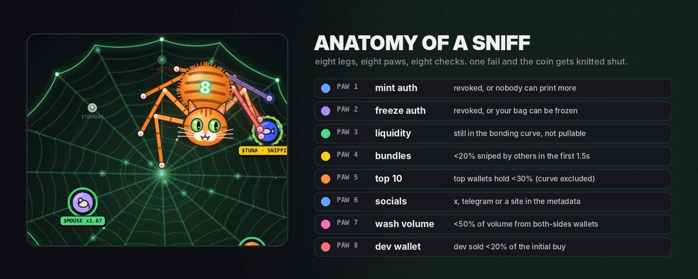</p>

Each paw answers **pass**, **fail** or **unknown**. A paw that can't tell says *unknown*. It never guesses a pass.

| Paw | Checks | Fails when | Where the data comes from |
|---|---|---|---|
| 1 | mint authority | it is still set (more tokens can be printed) | Solana RPC `getAccountInfo` |
| 2 | freeze authority | it is still set (your bag can be frozen) | Solana RPC `getAccountInfo` |
| 3 | liquidity | the coin left the bonding curve and the LP burn can't be confirmed (*unknown*) | pool field of the mint event |
| 4 | bundles | other wallets bought more than `MAX_BUNDLE_PCT` (20%) in the first 1.5 s | live PumpPortal trade stream |
| 5 | top 10 | the ten largest holders own more than `MAX_TOP10_PCT` (30%), bonding curve excluded | RPC `getTokenLargestAccounts` + owners |
| 6 | socials | the metadata has no X, Telegram or site at all | the token's metadata URI |
| 7 | wash volume | more than `MAX_WASH_PCT` (50%) of volume comes from wallets trading both sides | live trade stream |
| 8 | dev wallet | the creator already sold more than `MAX_DEV_SOLD_PCT` (20%) of their buy | live trade stream |

**The verdict** (`src/paws/verdict.ts`):

- **wrap**: any paw failed. The coin is knitted shut and never bought.
- **pounce**: zero fails and at least 6 clean paws.
- **watch**: no fails, but too many unknowns to trust it. Logged, not bought.

Paws 4, 7 and 8 need launch-time data, so `scan` on an old token reports them as *unknown*. `hunt` catches every mint the moment it lands and has all eight. Full details: [`docs/PAWS.md`](docs/PAWS.md).

<p align="center">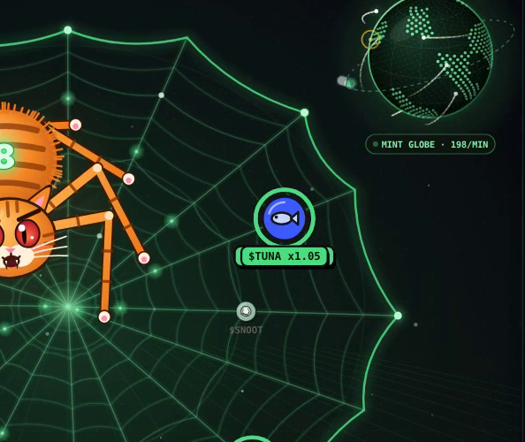<br><sub>Paw 8 touched the dev wallet. Dev sold 41%. Knitted shut.</sub></p>

---

## The hunt

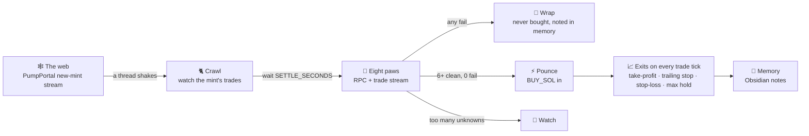

Code: [`src/trade/hunt.ts`](src/trade/hunt.ts), [`src/feed/pumpportal.ts`](src/feed/pumpportal.ts), [`src/feed/trail.ts`](src/feed/trail.ts).

---

## Knitting a meme

<p align="center">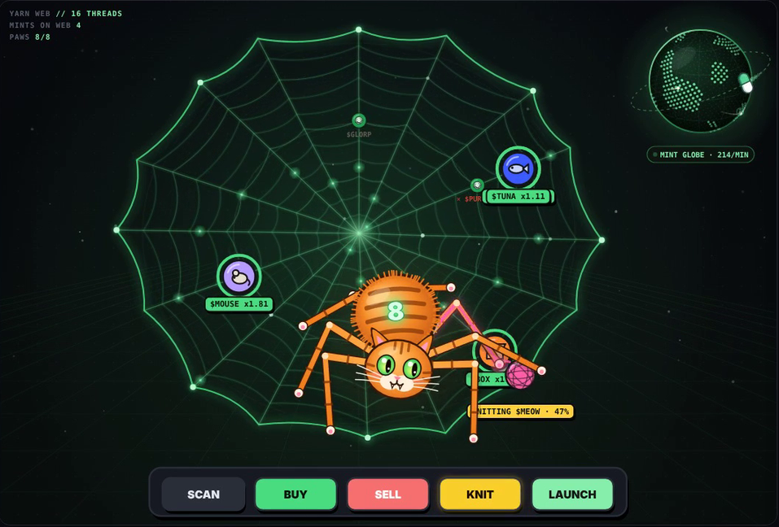</p>

`crawlcat knit` runs the crew once and produces a launch you can look at before anything happens:

```text
out/launches/MEOW/
  coin.png        ← the artist paints a yarn-ball coin locally (no image model needed)
  metadata.json   ← name, ticker, lore, socials
```

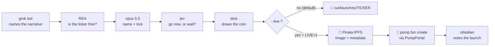

To launch for real you need `LIVE=1`, `PUMPPORTAL_API_KEY` and `PINATA_JWT` in `.env`, and the `--live` flag:

```bash
node src/cli.ts knit --name "Meow Coin" --ticker MEOW --lore "knitted at 3am" --live --dev-buy 0.5
```

If the timer seat says *wait*, the launch stops. Details and the exact request: [`docs/KNIT.md`](docs/KNIT.md).

<p align="center">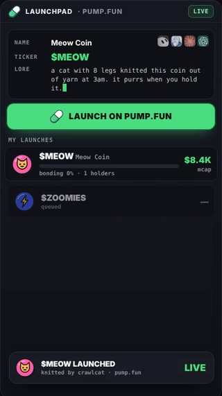</p>

---

## The crew

<p align="center">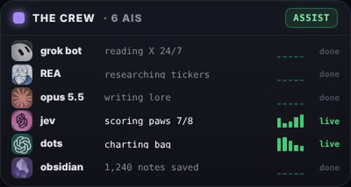</p>

Six seats around the cat. Each seat is a **role**, and any model can sit in it.

| Seat | Default name | Job | Without a key |
|---|---|---|---|
| `scout` | grok bot | reads X and names one memeable narrative | uses your theme |
| `researcher` | REA | checks the ticker isn't taken or a copycat | checks local memory |
| `writer` | opus 5.5 | writes the name, the ticker and the lore | cat-themed templates |
| `timer` | jev | says GO or WAIT | always GO in dry run |
| `artist` | dots | draws the coin | local yarn-ball renderer (always on) |
| `memory` | obsidian | keeps every draft, launch, pounce and rug as a note | `out/memory/` |

Plug a seat in with four variables. `FORMAT` is `openai` (any OpenAI-compatible API: xAI, OpenRouter, most hosts) or `anthropic`:

```bash
CREW_SCOUT_API_KEY=xai-...      CREW_SCOUT_BASE_URL=https://api.x.ai/v1     CREW_SCOUT_MODEL=grok-4
CREW_WRITER_API_KEY=sk-or-...   CREW_WRITER_BASE_URL=https://openrouter.ai/api/v1  CREW_WRITER_MODEL=<your-model>
```

`node src/cli.ts crew` shows who is connected. More in [`docs/CREW.md`](docs/CREW.md).

---

## The trade desk

<p align="center">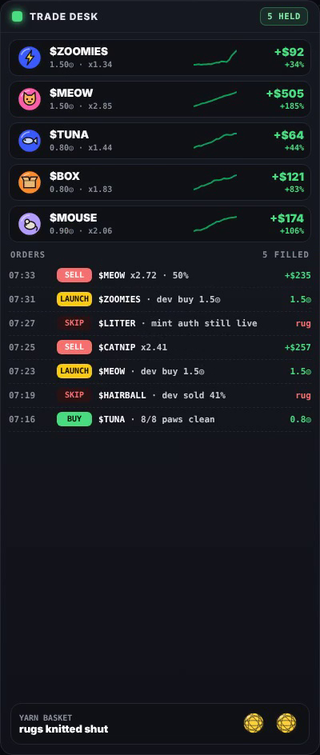</p>

Paper mode is the default and uses the **exact same exit rules** as live mode. Only the fill step changes.

| Rule | Default | What happens |
|---|---|---|
| `BUY_SOL` | 0.1 | size of every pounce |
| `TAKE_PROFIT_X` / `TAKE_PROFIT_FRACTION` | 2× / 50% | half the bag comes off at 2× |
| `TRAILING_STOP_PCT` | 25% | after take-profit, the rest trails the peak |
| `STOP_LOSS_PCT` | 35% | a loser is cut before take-profit |
| `MAX_HOLD_MINUTES` | 15 | nothing is held forever |
| `MAX_OPEN_POSITIONS` | 5 | the cat has only so many paws |

Live fills go through PumpPortal's Lightning trade API (`src/trade/lightning.ts`). It is the **only file** that can move real SOL, and it refuses unless `LIVE=1`. See [`docs/TRADING.md`](docs/TRADING.md).

---

## The Yarn Desk

<p align="center">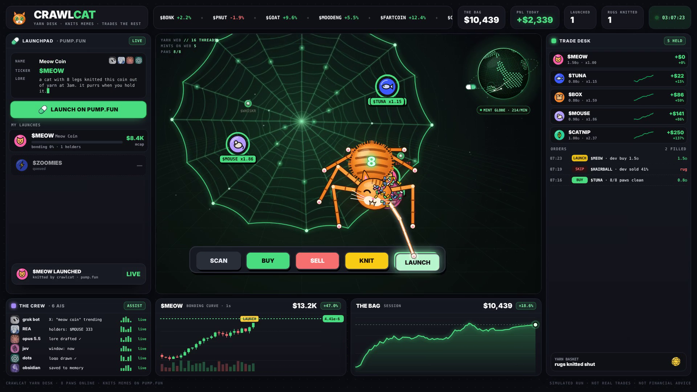</p>

`node src/cli.ts desk` serves the terminal from the video at `http://localhost:8808`: the **launchpad** on the left, the **cat on its web** in the middle with its console (SCAN · BUY · SELL · KNIT · LAUNCH), the **trade desk** on the right, the **crew**, the **bonding curve** and **the bag** along the bottom, and a mint globe spinning in the corner.

> Today the desk plays a **scripted demo session** (the one in the video). Wiring it to a live `hunt` over Server-Sent Events is the next item on the roadmap.

---

## Status: read this first

| Part | State |
|---|---|
| Eight paws: mint/freeze authority, top 10 (curve excluded), socials | ✅ **real data** from Solana RPC and the token metadata |
| Eight paws: bundles, wash volume, dev wallet | ✅ **real data** from the live PumpPortal trade stream, while hunting |
| Verdict (wrap / pounce / watch), paper bag and exit rules | ✅ **built and unit-tested** (`npm test`) |
| `hunt` in paper mode | ✅ real feed, paper fills |
| `knit` dry run: crew draft, local coin art, metadata, memory note | ✅ **works offline**, no keys needed |
| Crew seats on real models (OpenAI-compatible + Anthropic) | ✅ built; bring your own keys |
| Live trading via PumpPortal Lightning | ⚠️ **implemented, not yet battle-tested on mainnet.** Start with tiny sizes |
| Live launch (Pinata + PumpPortal create) | ⚠️ **implemented, not yet battle-tested.** Check PumpPortal's current create docs before the first run |
| Yarn Desk terminal | ✅ runs locally; ⏳ scripted demo, not yet wired to a live hunt |
| Numbers in the video and on the desk | 🎬 **simulated**. They show what the desk looks like, not results |
| A CrawlCat token | ❌ **there is none.** Anything claiming to be one isn't us |

---

## Safety

The short version (the long one is [`docs/SAFETY.md`](docs/SAFETY.md)):

1. **Paper first.** Run `hunt` for a few days before you even think about `LIVE=1`.
2. **Two locks for real money:** `LIVE=1` in `.env` *and* `--live` on the command line. Either one alone does nothing.
3. **Use a burner wallet** for your PumpPortal key, funded with what you can lose today.
4. **The paws reduce risk, they don't remove it.** A clean coin can still go to zero in a minute. Most memecoins do.
5. Nothing here is financial advice.

---

## Configuration

Everything lives in `.env` (see [`.env.example`](.env.example)). The important ones:

| Variable | Default | |
|---|---|---|
| `SOLANA_RPC_URL` | public mainnet RPC | use a private one, the public RPC rate-limits |
| `LIVE` | `0` | first of the two locks |
| `PUMPPORTAL_API_KEY` | — | Lightning API key; its wallet trades and launches |
| `PINATA_JWT` | — | hosts launch images and metadata |
| `SETTLE_SECONDS` | `8` | how long a mint sits on the web before the paws tap it |
| `MAX_*_PCT` | see above | paw thresholds |
| `OBSIDIAN_VAULT` | — | notes go to `<vault>/CrawlCat/` |

---

## Architecture

```text
src/
  cli.ts               scan · hunt · knit · crew · desk
  config.ts            .env loader, every default in one place
  log.ts               MEOW / SNIFF / POUNCE / HISS / BOOP / KNIT lines
  util/base58.ts       Solana base58, no deps
  util/keypair.ts      ed25519 keypairs via node:crypto (64-byte Solana secrets)
  solana/rpc.ts        bare JSON-RPC: mint info, largest holders, supply
  feed/pumpportal.ts   the web: new-mint + trade WebSocket with reconnect
  feed/trail.ts        per-mint memory: bundles, wash volume, dev selling
  paws/checks.ts       the eight paws
  paws/verdict.ts      wrap · pounce · watch
  trade/paper.ts       paper bag and exit rules
  trade/lightning.ts   live fills (LIVE=1 only)
  trade/hunt.ts        the hunt loop
  launch/png.ts        tiny rasterizer + PNG encoder: the artist's hands
  launch/pinata.ts     IPFS hosting for launch metadata
  launch/knit.ts       draft → art → metadata → launch
  crew/llm.ts          one client, two wire formats
  crew/roles.ts        the six seats and the offline brain
  crew/memory.ts       Obsidian notes
  desk/server.ts       serves web/desk.html
web/desk.html          the Yarn Desk terminal
test/core.test.ts      base58, keypairs, trail math, verdicts, exits, PNG
```

**Stack:** Node 22 (native TypeScript, `fetch`, `WebSocket`, `node:crypto`, `node:zlib`, `node:test`). Nothing else.

---

## Roadmap

- [x] Eight paws, verdicts, paper bag, exit rules, tests
- [x] Crew with pluggable seats and an offline brain
- [x] Knit: local coin art, metadata, dry run, live create
- [x] Yarn Desk terminal (demo session)
- [ ] Desk ↔ live hunt over Server-Sent Events
- [ ] Wallet-history paw: the creator's previous launches and how they ended
- [ ] Telegram pings when the cat pounces or wraps
- [ ] Backtest mode: replay a recorded day of the web through the paws

---

## FAQ

**Why a cat with eight legs?** One paw per check. Also it looks great on a web.

**Does it make money?** Nobody can promise that, and the cat doesn't. The paws exist so it loses less to the obvious stuff.

**Can I change the checks?** Every threshold is an env var. The checks themselves are one file: `src/paws/checks.ts`.

**Why no dependencies?** Fewer packages, fewer supply-chain surprises in a tool that can spend your SOL.

---

<p align="center">
  <sub>MIT licensed · not financial advice · simulated numbers in the media are simulated<br>
  one man's rug is a cat's yarn ball 🧶</sub>
</p>
